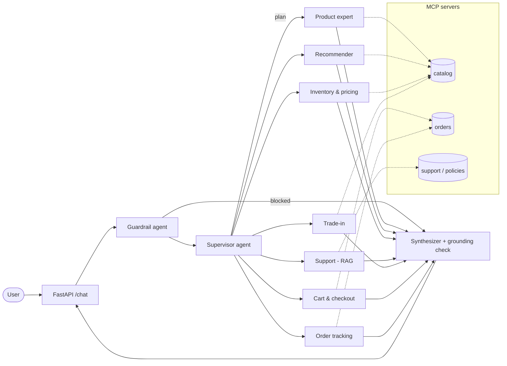

# iPhone Store Agents

A multi-agent shopping assistant for an iPhone store. A **LangGraph** supervisor routes each message to specialist agents. The agents reach the store's data only through three **MCP servers**. Policy questions are answered with **RAG** and cited sources, and everything is served by **FastAPI**.


  

```text
$ python -m app.cli --trace
you> trade in my iphone 13 in fair condition for a 17 pro

bot> Your iPhone 13 in fair condition is worth about Rs 13,200. That brings the iPhone 17 Pro down to
     Rs 1,21,700 (from Rs 1,34,900). The final value is confirmed when the courier inspects the phone.

     [guardrail     ]    0.5 ms  tools: -
     [supervisor    ]    3.2 ms  tools: -
     [trade_in      ]   15.8 ms  tools: catalog.estimate_trade_in, catalog.get_product
     [synthesizer   ]    0.0 ms  tools: -
```

## What it does

| Ask | What happens |
|---|---|
| "Compare iPhone 17 vs 17 Pro" | Spec table from the catalog server |
| "Best iPhone for photography under 1 lakh" | Ranked picks with the reason for each |
| "Is the 17 Pro Max in stock in Hyderabad?" | Stock in that city, other cities that have it, delivery time, best bank offer |
| "Can I return an opened iPhone?" | RAG answer with a citation such as `[returns.md#Return window]` |
| "Trade in my iPhone 13 for a 17 Pro" | Trade-in quote and the net price |
| "Add the 17 Pro 512GB to my cart" → "Checkout with UPI" → "yes" | Cart, then a confirmation step, then the order |
| "Where is ORD-1001?" / "Cancel ORD-1002" | Order status, or cancellation if it hasn't shipped |
| "Price of the 17 in Mumbai, and what are the EMI options?" | **Two agents in one turn**: inventory, then support |

## Architecture



### The 10 agents

| Agent | Job | MCP tools it uses |
|---|---|---|
| **Guardrail** | Blocks prompt injection and oversized input. Masks card numbers (Luhn-checked) before anything is stored. | – |
| **Supervisor** | Classifies intents, extracts entities (SKUs, budget, city, order ID…) and writes an ordered `plan` of specialists | – |
| **Product expert** | Specs for one model, or a comparison table | `get_product`, `compare_products` |
| **Recommender** | Ranks models by budget and use case with an explainable score | `search_products` |
| **Inventory & pricing** | Stock by city, delivery time, best offer | `get_product`, `check_stock`, `get_offers` |
| **Support** | Answers policy questions from retrieved sections only, with citations | `search_policies` |
| **Trade-in** | Values an old iPhone and works out the net price | `estimate_trade_in`, `get_product` |
| **Cart & checkout** | Adds to the cart, then checks out with **human-in-the-loop confirmation** | `add_to_cart`, `view_cart`, `place_order` |
| **Order tracking** | Status and ETA, or cancellation | `get_order`, `cancel_order` |
| **Synthesizer** | Merges the findings into one reply. When an LLM is on, it rewrites them and checks the result is grounded. | – |

### The 3 MCP servers

Each server is a standalone `MCPServer` (MCP Python SDK 2.3, spec 2026-07-28). It can run in-process or over streamable HTTP.

| Server | Tools | Resources |
|---|---|---|
| `catalog` | `search_products`, `get_product`, `compare_products`, `check_stock`, `get_offers`, `estimate_trade_in` | `store://catalog` |
| `orders` | `add_to_cart`, `view_cart`, `clear_cart`, `place_order`, `get_order`, `cancel_order` | – |
| `support` | `search_policies` | `store://policies/{name}` |

The agents never import server code. They call tools through `MCPToolbox`, so moving a server to its own container only means changing a URL (see `docker-compose.yml`). The servers also work with any other MCP host:

```bash
claude mcp add --transport http iphone-catalog http://localhost:8101/mcp
```

## Design decisions

- **Plan-based routing, not one agent per message.** The supervisor writes an ordered plan and `route_next` walks through it. This lets one message such as "compare these and tell me the return policy" run two specialists in order, and the synthesizer merges both results.
- **Human-in-the-loop for money.** `place_order` never runs in the same turn as "checkout". The cart agent stores a `pending_action` in graph state, which the checkpointer keeps per session, and waits for an explicit "yes". A test checks that no order exists before confirmation.
- **The LLM is optional, and every LLM output is checked.** With `LLM_PROVIDER=offline` the whole system is deterministic, which is how the tests and CI run. With Claude on:
  - The router's intents are filtered against an allow-list.
  - Product names are resolved to SKUs by code, so the model can't invent a product.
  - The writer's reply is **grounding-checked**: every rupee amount in it must appear in the tool outputs. If one doesn't, the deterministic answer is used instead and the trace shows `grounding_check: failed_fallback`.
  - If the API fails, the system falls back to the deterministic path instead of returning a 500.
- **Query rewriting for RAG.** In mixed messages, only the policy clause is sent to retrieval. "Price of the 17 in Mumbai, and EMI options" searches for "EMI options", so the delivery-to-Mumbai policy doesn't get pulled in.
- **RAG that refuses to guess.** Hits below `RAG_MIN_SCORE` are dropped. With no hits, the agent offers a human hand-off. Every sentence in an answer carries its source.
- **Tool errors are data, not crashes.** Servers raise `ToolError`. The MCP client gets `isError=True`, and the agent turns it into a message the customer can act on ("ORD-1001 has already shipped; use the returns process instead").
- **Observability built in.** Every response includes a `trace` with each agent, its latency and the MCP tools it called, including failed calls.

## Quick start

```bash
git clone https://github.com/anilch963/iphone-store-agents.git
cd iphone-store-agents
python -m venv .venv && source .venv/bin/activate
pip install -r requirements-dev.txt

uvicorn app.api.main:app --reload     # chat UI at http://localhost:8000, API docs at /docs
python -m app.cli --trace             # or chat in the terminal
pytest                                # 65 tests, no API key needed
```

To use Claude for routing and writing replies:

```bash
cp .env.example .env    # set LLM_PROVIDER=anthropic and ANTHROPIC_API_KEY
```

To run each MCP server as its own service:

```bash
docker compose up --build
```

### API

```bash
curl -s localhost:8000/chat -H 'content-type: application/json' \
  -d '{"message": "is the 17 pro in stock in chennai?", "session_id": "demo"}'
```

```jsonc
{
  "session_id": "demo",
  "answer": "**iPhone 17 Pro**: Rs 1,34,900, out of stock in Chennai (available in Bengaluru, Hyderabad, Mumbai, Delhi), delivery in 3-5 days. With offer BANK5 you pay Rs 1,28,900 (save Rs 6,000).",
  "intents": ["stock_price"],
  "agents": ["guardrail", "supervisor", "inventory", "synthesizer"],
  "citations": [],
  "pending_confirmation": false,
  "grounded": true,
  "trace": [ /* guardrail, supervisor, then: */ {"agent": "inventory", "ms": 14.2, "tools": ["catalog.get_product", "catalog.check_stock", "catalog.get_offers"]}]
}
```

| Endpoint | |
|---|---|
| `POST /chat` | One turn. Pass `session_id` again to keep the cart and context. |
| `GET /sessions/{id}` | History, city, last products discussed, pending action |
| `GET /tools` | Tools exposed by each MCP server |
| `GET /health` | Liveness |

## Testing and evaluation

```text
tests/test_nlu.py           routing for 14 phrasings, budget parsing, trade-in vs target model
tests/test_mcp_servers.py   tool contracts through a real MCP client, including error cases
tests/test_rag.py           retrieval eval on 12 labelled questions + answer faithfulness
tests/test_graph.py         full conversations: multi-intent, context carry-over, HITL checkout, guardrails
tests/test_llm_mode.py      stubbed LLM: hallucinated price triggers fallback, router can't invent intents, outage
tests/test_api.py           FastAPI endpoints and session persistence
```

Retrieval on the labelled set (`tests/test_rag.py`; CI fails if it drops):

| Metric | Result | Threshold |
|---|---|---|
| hit@1 | 11/12 (92%) | ≥ 90% |
| hit@3 | 12/12 (100%) | 100% |

The one hit@1 miss ("which phones can I trade in") is a lexical-retrieval limitation. It's the first thing dense embeddings would fix.

## Project structure

```text
app/
  agents/          guardrail, supervisor, 7 specialists, synthesizer, shared state
  mcp_servers/     catalog, orders, support (each runnable on its own)
  rag/retriever.py section chunking + TF-IDF index behind a Retriever protocol
  data/            sample catalog and policy documents
  api/             FastAPI app and chat UI
  graph.py         LangGraph wiring and checkpointer
  nlu.py           deterministic intent and entity extraction
  llm.py           optional Claude client with graceful fallback
  mcp_client.py    MCPToolbox: in-process or HTTP, with call logging
tests/
```

## Roadmap

- Dense or hybrid retrieval (pgvector or Chroma) behind the existing `Retriever` protocol
- Postgres checkpointer and order store, so sessions survive restarts
- Langfuse or LangSmith tracing, plus token cost per turn
- OAuth on the MCP servers (the SDK supports `auth=`) and per-customer order access
- Streaming responses over SSE

---

Product names belong to Apple. Prices, stock, offers and policies in `app/data/` are sample data for the demo, not official figures.
